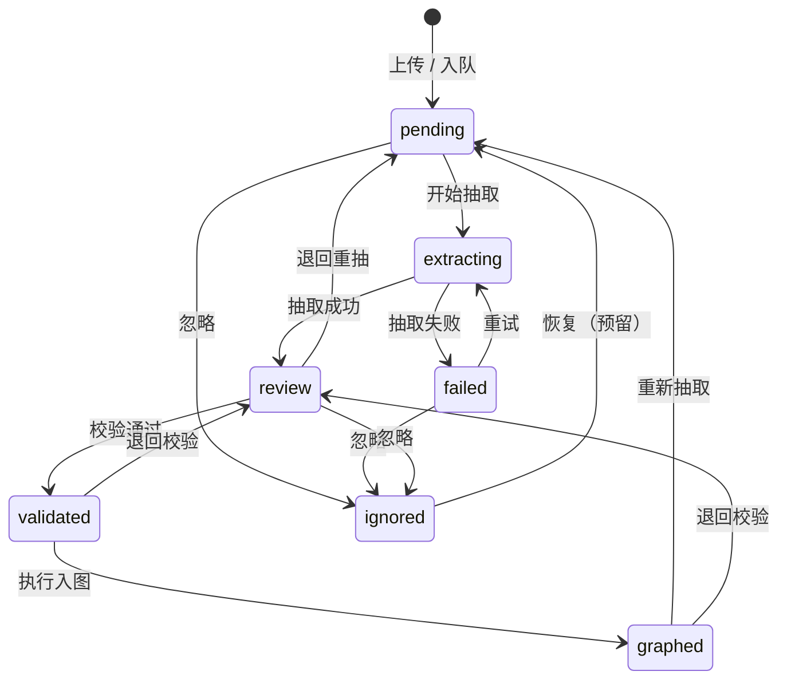
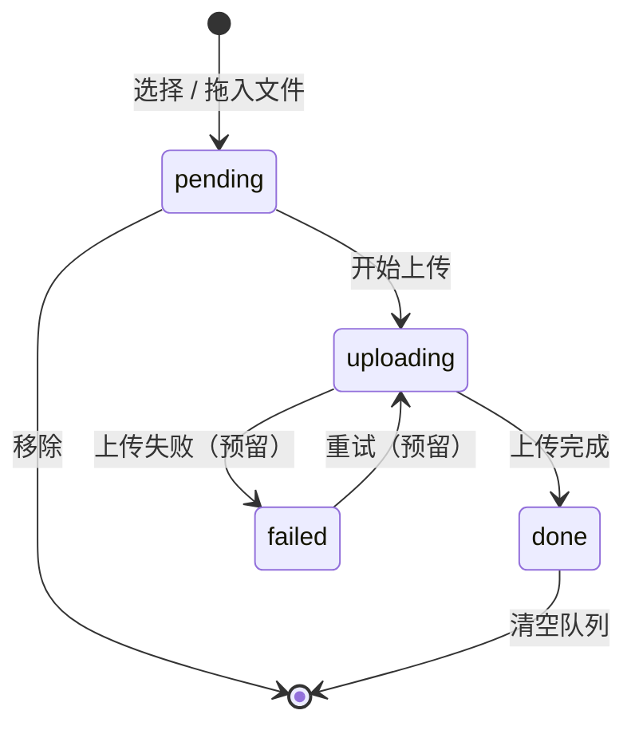
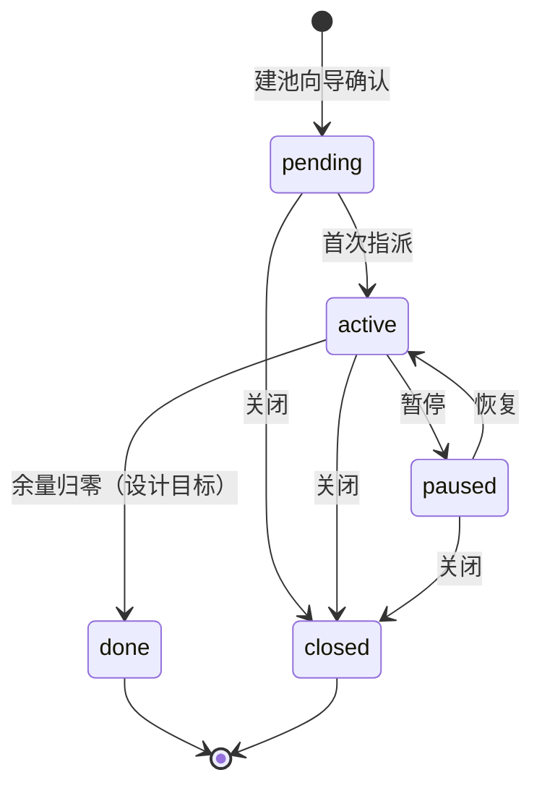
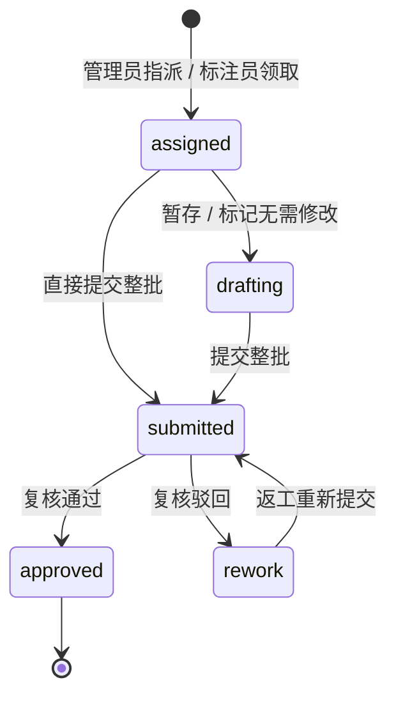
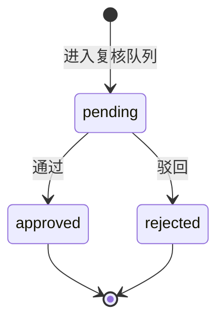
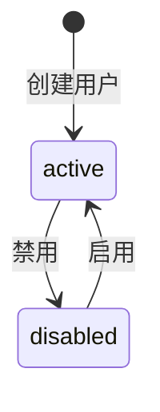
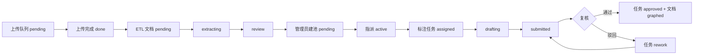

# 事务状态流转模型

> 本文档描述 TCM-DOR 原型中各业务实体的状态、流转条件、操作者与代码实现位置。
> 状态值大小写与代码保持一致；标注「已接入 / 本地 mock / 预留」区分当前实现程度。

---

## 0. 阅读说明

| 标记 | 含义 |
|---|---|
| 已接入 | 状态由 store 管理，跨页面生效并持久化 |
| 本地 mock | 状态只存在于当前页面/组件内，刷新后重置 |
| 预留 | 状态或流转已定义，但当前 UI 未使用 |
| 设计目标 | 业务上应有的流转，原型暂未自动实现 |

状态持久化说明：

- ETL 文档状态、标注任务状态写入 localStorage
- 任务池、复核条目、用户列表当前为页面内 mock，刷新后重置
- 上传队列、工作台条目状态不持久化

---

## 1. 实体与状态总览

| 实体 | 状态 | 管理位置 | 实现程度 |
|---|---|---|---|
| ETL 文档 | `pending` / `extracting` / `failed` / `review` / `validated` / `graphed` / `ignored` | `stores/etl.js` | 已接入 |
| 上传队列项 | `pending` / `uploading` / `done` / `failed` | `DataSourceResourceView.vue` | 本地 mock |
| 任务池 | `pending` / `active` / `paused` / `done` / `closed` | `AnnotationTasksView.vue` | 本地 mock |
| 标注任务 | `assigned` / `drafting` / `submitted` / `approved` / `rework` | `stores/annotation.js` | 已接入 |
| 标注条目（工作台） | `待标注` / `已暂存` / `已提交` | `WorkbenchView.vue` | 本地 mock |
| 复核条目 | `pending` / `approved` / `rejected` | `AnnotationTasksView.vue` | 本地 mock |
| 用户账号 | `active` / `disabled` | `UsersView.vue` | 本地 mock |
| 数据记录展示状态 | `extracted` / `review` / `failed` | `data/dorMock.js` | 展示映射 |

---

## 2. ETL 文档状态机

### 2.1 状态定义

| 状态 | UI 文案 | 含义 |
|---|---|---|
| `pending` | 待抽取 | 已入队，等待开始抽取 |
| `extracting` | 抽取中 | LLM 正在解析文档 |
| `failed` | 抽取失败 | 超时 / 版式 / 字段异常 |
| `review` | 待校验 | 抽取完成，等待人工确认 |
| `validated` | 待入图 | 校验通过，等待建图 |
| `graphed` | 已完成 | 已入知识图谱 |
| `ignored` | 已忽略 | 不参与处理流程 |

### 2.2 状态流转图



### 2.3 流转明细

| 当前状态 | 目标状态 | 触发动作 | 操作者 | 代码 |
|---|---|---|---|---|
| — | `pending` | 上传文件入队 | 管理员 | `etlStore.addDocs()` |
| `pending` | `extracting` | 开始抽取 | 管理员 | `etlStore.setState(ids, "extracting")` / `startExtraction()` |
| `failed` | `extracting` | 重试抽取 | 管理员 | `retry()` |
| `extracting` | `review` | 抽取成功 | 系统 | 当前 mock 未自动流转，由演示数据直接置为 review |
| `extracting` | `failed` | 抽取失败 | 系统 | 当前 mock 未自动流转 |
| `review` | `validated` | 校验通过 | 管理员 | `approve()`（当前 UI 未接入） |
| `review` | `pending` | 退回重抽 | 管理员 | `reject()` / `setState(..., "pending")` |
| `validated` | `graphed` | 执行入图 | 管理员 | `buildGraph()`（当前 UI 未接入） |
| `validated` | `review` | 退回校验 | 管理员 | `backToReview()`（当前 UI 未接入） |
| `graphed` | `pending` | 重新抽取 | 管理员 | `reextract()`（当前 UI 未接入） |
| `graphed` | `review` | 退回校验 | 管理员 | `backToReview()`（当前 UI 未接入） |
| `pending` / `failed` / `review` | `ignored` | 忽略 | 管理员 | `ignore()`（当前 UI 未接入） |
| 任意 | 删除 | 删除资源 | 管理员 | `etlStore.removeDocs()` |

> 当前资源管理页实际接入的动作：抽取、取消抽取、删除、批量删除 / 设置 / 抽取 / 取消抽取。
> 标注复核通过时，`annotationStore.approve()` 会把任务文档直接置为 `graphed`。

### 2.4 说明

- `validated` 是完整业务状态，但当前原型没有单独「待入图」操作入口。
- `uploaded` 是旧上传队列遗留值，不在 `ETL_STATES` 中，当前 UI 不使用。
- ETL 文档状态通过 `tcm-dor-etl-doc-states-v1` 持久化。
- 新增文档（`addDocs()`）仅存在于当前会话内存，刷新后文档列表回到 mock；状态映射键只覆盖 mock 中已有的文档 ID。
- 初始 mock 状态分布：待抽取 8、抽取中 3、失败 5、待校验 16、已入图 6、已忽略 2。

---

## 3. 上传队列状态

### 3.1 状态定义

| 状态 | UI 文案 | 含义 |
|---|---|---|
| `pending` | 待上传 | 已加入队列，等待上传 |
| `uploading` | 上传中 | 模拟上传进行中 |
| `done` | 已完成 | 上传完成 |
| `failed` | 失败 | 上传失败（预留） |

### 3.2 状态流转图



### 3.3 规则

- 队列上限 10 个文件
- `uploading` 状态下不可修改文件类型
- 上传完成后：
  1. 队列项置为 `done`
  2. 调用 `etlStore.addDocs()` 创建 `pending` 文档
  3. 清空队列并关闭弹窗
- 当前为模拟上传，不读取真实文件内容，不连接后端

实现位置：`views/admin/datasource/DataSourceResourceView.vue`

---

## 4. 任务池状态

### 4.1 状态定义

| 状态 | UI 文案 | 含义 |
|---|---|---|
| `pending` | 待指派 | 已建池，尚未指派 |
| `active` | 进行中 | 已指派，标注员可领取 |
| `paused` | 已暂停 | 暂停领取 |
| `done` | 已完成 | 余量为 0 |
| `closed` | 已关闭 | 管理员关闭，余量退回 |

### 4.2 状态流转图



### 4.3 流转明细

| 当前状态 | 目标状态 | 触发动作 | 代码 |
|---|---|---|---|
| — | `pending` | 建池向导确认 | `confirmPool()` |
| `pending` | `active` | 首次指派文档 | `confirmAssign()` |
| `active` | `paused` | 暂停 | `togglePause()` |
| `paused` | `active` | 恢复 | `togglePause()` |
| `active` / `paused` / `pending` | `closed` | 关闭 | `closePool()` |
| `active` | `done` | 余量归零 | 设计目标，当前 mock 未自动流转 |

### 4.4 规则

- 指派后 `remaining` 减少，并写入 `claims` 领取记录
- 关闭池后余量退回待分配（mock 提示）
- `done` 当前只作为初始 mock 状态存在，未实现余量归零自动切换
- 任务池数据当前为页面内 mock，不持久化

实现位置：`views/admin/AnnotationTasksView.vue`

---

## 5. 标注任务状态

标注任务是最核心的跨角色状态机，连接管理员、标注员、复核员。

### 5.1 状态定义

| 状态 | UI 文案 | 含义 |
|---|---|---|
| `assigned` | 待标注 | 已指派，尚未开始 |
| `drafting` | 标注中 | 已暂存至少一条 |
| `submitted` | 待复核 | 已提交，等待复核 |
| `approved` | 已通过 | 复核通过，文档入图 |
| `rework` | 返工中 | 复核驳回，需修改 |

### 5.2 状态流转图



### 5.3 流转明细

| 当前状态 | 目标状态 | 触发动作 | 操作者 | 代码 |
|---|---|---|---|---|
| — | `assigned` | 管理员指派 / 标注员领取 | 管理员 / 标注员 | `annotationStore.assign()` |
| `assigned` | `drafting` | 暂存本条 / 标记无需修改 | 标注员 | `markDrafting()` |
| `assigned` / `drafting` | `submitted` | 提交整批 | 标注员 | `submitByDocs()` |
| `rework` | `submitted` | 返工重新提交 | 标注员 | `resubmit()` / `submitByDocs()` |
| `submitted` | `approved` | 复核通过 | 管理员 | `approve()` |
| `submitted` | `rework` | 复核驳回 | 管理员 | `reject()` |
| `approved` | — | 终态 | — | — |

### 5.4 规则与约束

- 同一任务内的文档必须属于同一类型（文献 / 病案）
- `assigned`、`drafting`、`rework`、`submitted` 视为活跃状态，其文档不可被其他任务重复领取
- `approve()` 会把任务内文档置为 `graphed`
- `reject()` 会记录 `rejectedAt`
- 标注任务状态通过 `tcm-dor-annotation-tasks-v2` 持久化
- 标注员工作台只展示 `assigned` / `drafting` 任务卡片；`rework` 在返工箱处理

### 5.5 与复核 UI 的关系

`annotationStore.approve()` / `reject()` 已实现完整状态流转，但当前管理员「复核队列」使用页面内 mock 的 `REVIEW_TASKS` 与 `entry.status`，尚未调用 store 方法。

也就是说：

- **设计链路**：复核通过 → `annotationStore.approve()` → 任务 `approved` + 文档 `graphed`
- **当前原型**：复核条目在页面内从 `pending` 变为 `approved` / `rejected`

后续接入真实复核时，将 `approveEntry()` / `rejectEntry()` 接到 store 即可。

---

## 6. 标注条目状态（工作台）

工作台中的每一条文档还有一层页面级状态，用于控制暂存与提交。

| 状态 | 触发动作 | 说明 |
|---|---|---|
| `待标注` | 进入任务 / 切换条目 | 初始状态 |
| `已暂存` | 暂存本条 / 标记无需修改 | 仅保存在当前页面内存 |
| `已提交` | 提交整批 | 提交后本批次不可再编辑 |

说明：

- 这是**条目级 UI 状态**，不是任务级状态
- 条目状态不持久化，刷新后重置
- 任务级状态由 `annotationStore` 管理

实现位置：`views/annotator/WorkbenchView.vue`

---

## 7. 复核条目状态

### 7.1 状态定义

| 状态 | UI 文案 | 含义 |
|---|---|---|
| `pending` | 待复核 | 等待管理员判断 |
| `approved` | 已通过 | 变更合入母版 |
| `rejected` | 已驳回 | 退回标注员修改 |

### 7.2 状态流转图



### 7.3 规则

- 只有 `pending` 条目可执行通过 / 驳回
- 通过：字段变更合入母版（设计语义）
- 驳回：退回标注员，任务进入返工箱（设计语义）
- 当前为页面内 mock，不持久化

实现位置：`views/admin/AnnotationTasksView.vue`

---

## 8. 用户账号状态

### 8.1 状态定义

| 状态 | UI 文案 | 含义 |
|---|---|---|
| `active` | 启用 | 可登录使用 |
| `disabled` | 禁用 | 禁止登录 |

### 8.2 状态流转图



### 8.3 规则

- 新建用户默认为 `active`
- 支持启用 / 禁用切换
- 当前不支持删除用户
- 角色在创建时确定，当前列表页不提供角色修改
- 用户数据为页面内 mock，不持久化

实现位置：`views/admin/UsersView.vue`

---

## 9. 数据记录展示状态

数据管理列表使用独立的展示状态，与 ETL 状态机是映射关系，不是完整状态机。

| 展示状态 | UI 文案 | 对应 ETL 语义 |
|---|---|---|
| `extracted` | 已抽取 | 抽取成功，可人工校验 |
| `review` | 待复核 | 需要人工确认 |
| `failed` | 失败 | 抽取失败 |

实现位置：`data/dorMock.js` 的 `DOR_STATUS_META`。

---

## 10. 端到端状态联动

完整设计链路：



对应规则：

1. 上传队列完成后，文档以 `pending` 进入 ETL
2. 抽取成功后文档进入 `review`，才可被建池 / 指派
3. 任务池指派后创建标注任务，任务为 `assigned`
4. 标注员暂存 → `drafting`，提交 → `submitted`
5. 复核通过 → `approved`，文档 `graphed`
6. 复核驳回 → `rework`，重新提交 → `submitted`

> 当前原型中第 5、6 步在管理员复核 UI 内为页面级 mock；store 侧已具备完整方法。

---

## 11. 状态不变量

- 上传队列最多 10 项
- 一个标注任务内的文档类型必须一致
- `availableDocs()` 只返回 `review` 且未被活跃任务占用的文档
- 活跃任务状态集合：`assigned`、`drafting`、`rework`、`submitted`
- `approved` 任务的文档状态应为 `graphed`
- 任务池 `remaining` 不得小于 0
- 关闭任务池后余量退回待分配（mock）
- 复核条目只有 `pending` 可被操作

---

## 12. 持久化与重置

| 数据 | localStorage 键 | 是否持久化 |
|---|---|---|
| 当前角色 | `tcm-dor-proto-role` | 是 |
| 侧栏折叠 | `tcm-dor-proto-sidebar-collapsed` | 是 |
| 对话历史 | `tcm-dor-chat-history-v1` | 是 |
| ETL 文档状态 | `tcm-dor-etl-doc-states-v1` | 是 |
| 标注任务 | `tcm-dor-annotation-tasks-v2` | 是 |
| 基础配置 | `tcm-dor-etl-config-v1` | 是 |
| 上传队列 | — | 否 |
| 任务池 | — | 否 |
| 复核条目 | — | 否 |
| 工作台条目状态 | — | 否 |
| 用户列表 | — | 否 |

重置原型：

```js
localStorage.clear();
location.reload();
```

---

## 13. 实现映射

| 能力 | 文件 |
|---|---|
| ETL 状态机 | `src/stores/etl.js` |
| 标注任务状态机 | `src/stores/annotation.js` |
| 资源上传 / 队列 | `src/views/admin/datasource/DataSourceResourceView.vue` |
| 任务池 / 复核 / 日志 | `src/views/admin/AnnotationTasksView.vue` |
| 标注工作台 | `src/views/annotator/WorkbenchView.vue` |
| 任务领取 | `src/views/annotator/ClaimTasksView.vue` |
| 用户账号 | `src/views/admin/UsersView.vue` |
| 记录展示状态 | `src/data/dorMock.js` |

---

## 14. 原型差异与后续接入点

| 项目 | 当前状态 | 后续 |
|---|---|---|
| 管理员复核 → 标注任务 store | 页面级 mock | `approveEntry` / `rejectEntry` 接入 `annotationStore` |
| `validated` 待入图 | 已定义未使用 | 增加「校验通过 / 入图」入口 |
| 任务池余量归零 → `done` | 未自动流转 | 指派后判断 `remaining === 0` |
| 上传失败 → `failed` | 已定义未触发 | 增加失败模拟 / 重试 |
| 用户角色修改 | 不支持 | 增加角色编辑与权限校验 |
| 真实文件上传 / 抽取 | 无 | 接入后端与 LLM 服务 |
| 服务端持久化 | 无 | 接入数据库与鉴权 |

---

## 15. 相关文档

- [README · 完整设计说明](../README.md)
- [Nginx 部署配置](../deploy/nginx.conf)
